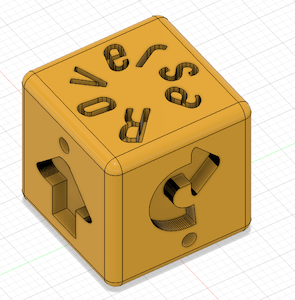
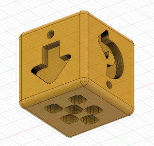
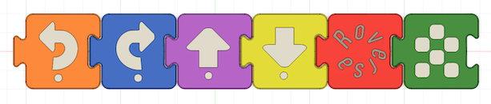

# roversa-quest - 3D Print and CAD files for Roversa Adventure Quest game

A 6-sided die with faces corresponding to the Roversa buttons and matching game pieces.






---

## Fusion 360

Source designs live in Fusion 360 under the kim@roversa.com account:
- roversa-quest - the gamepieces
- direction-die - the 6-sided die

## Repository Structure

The files in this repository

```
├── cad/
│   ├── direction-die.f3d         # Native Fusion 360 parametric design archive
│   └── roversa-quest.f3d         # Native Fusion 360 parametric design archive
├── exports/
│   ├── directional-die.step      # Universal CAD exchange format for solid modeling
│   ├── roversa-quest.step        # Universal CAD exchange format for solid modeling
│   ├── 3mf/                      # Mesh format preserving 2-color print structure
│   └── stl/                      # Portable format for import into Tinkercad
└── README.md                     # Project overview and finishing guide
```

* **`cad/`**: Contains the original Fusion 360 source archive (`.f3d`) preserving feature history, sketches, and parametric dimensions.
* **`exports/`**: Contains production-ready files including standard `.3mf` for 3D printer slicers, `.stl` files for import into Tinkercad and high-precision `.step` files for import into other CAD software.

NOTE: each update that changes the f3d file should also update the step, 3mf and obj files accordingly.
